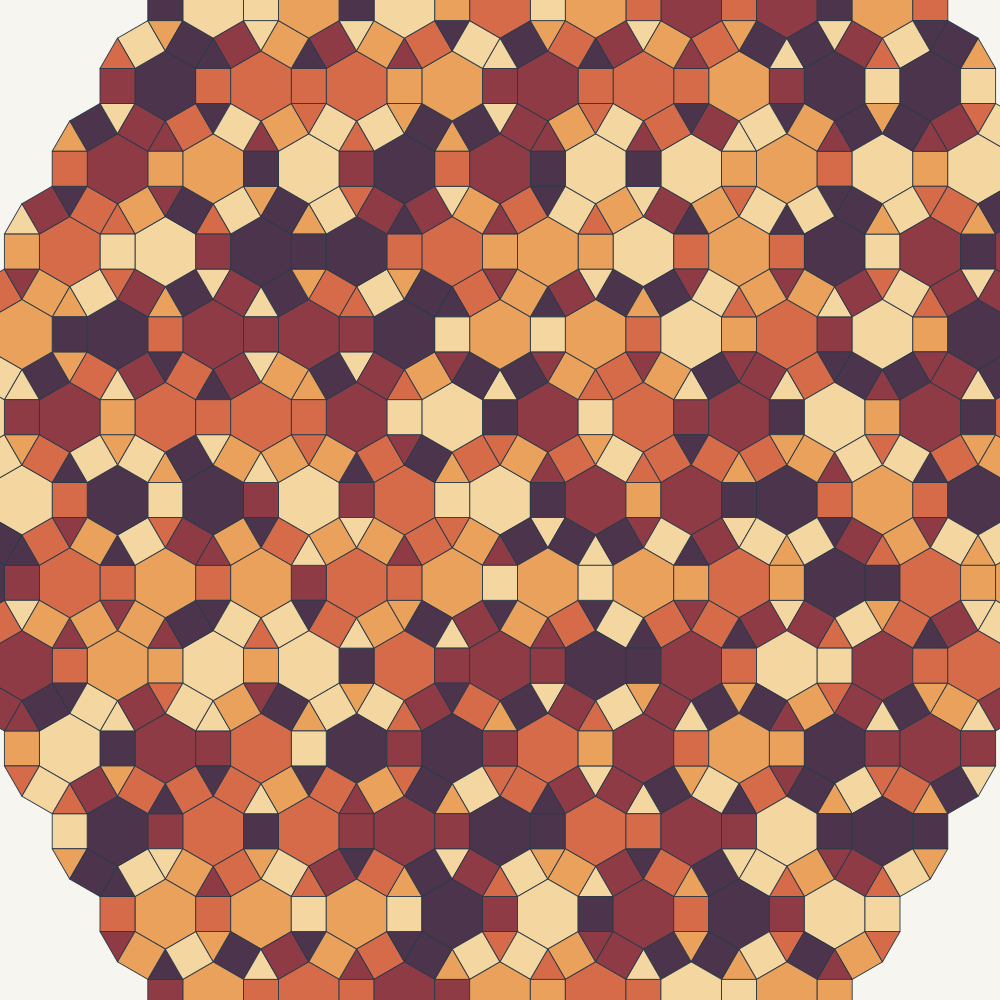

# Tessera

Tessera is a lightweight Python explorer for periodic, aperiodic and **k-uniform edge-to-edge tilings** made from regular polygons. It writes plain SVG and has no third-party runtime dependencies.

<p align="center">
  
</p>

<p align="center">
  <em>Mixed regular-polygon tiling generated with Tessera.</em>
</p>

## Install

```bash
python -m venv .venv
# macOS/Linux: source .venv/bin/activate
# Windows PowerShell: .venv\Scripts\Activate.ps1
python -m pip install -e .
```

Python 3.10 or newer is required.

## Explore k-uniform tilings

A k-uniform tiling has exactly *k* symmetry orbits of vertices. A vertex figure describes the polygons meeting at one vertex; a tiling may have fewer distinct vertex figures than vertex orbits. Tessera includes a reference catalogue labelled from k=1 through k=4, plus a generator that accepts custom GomJau-Hogg construction notation.

List the built-in examples:

```bash
tessera --list-uniform --max-k 4
```

Render a catalogue entry by ID:

```bash
tessera --uniform u07 -o hexagons-squares-triangles.svg
tessera --uniform u09 -o octagons-squares.svg
tessera --uniform u4-01 -o four-uniform.svg
```

Render a construction directly from its notation:

```bash
tessera --notation '6-4-3/m30/r(c2)' -o 3464.svg
```

`--tile-size` sets the overall scale; all polygons in a valid construction share a common edge length. `--max-repeat` controls how far the symmetry operations expand the patch:

```bash
tessera --uniform u4-01 --tile-size 72 --max-repeat 14 --width 1200 --height 900 -o exploration.svg
```

### Built-in reference catalogue

The current starter catalogue contains 19 reference constructions:

| Uniformity | Included locally | Known complete total | Local coverage |
|---|---:|---:|---|
| k=1 | 11 | 11 | Complete |
| k=2 | 4 | 20 | Representative examples |
| k=3 | 3 | 61 | Representative examples |
| k=4 | 1 | 151 | One reference construction |

**The local catalogue is not an exhaustive classification.** The counts in the third column are the published totals for the complete Euclidean edge-to-edge regular-polygon lists; Tessera currently stores 19 selected constructions. It can generate additional patterns from valid GomJau-Hogg notation, but it does not automatically discover every valid notation or certify an arbitrary user-supplied pattern's k-uniformity. For browsing all 151 known 4-uniform tilings, use [The Tiling Atlas](https://www.thetilingatlas.com/catalogue), which currently contains the complete k-uniform catalogue through k=16.

## Mixed regular polygons

The `uniform` generator builds edge-to-edge patches from regular polygons sharing a common edge length. Two included examples:

- `6-4-3/m30/r(c2)`: the 3.4.6.4 tiling, containing regular hexagons, squares and equilateral triangles.
- `8-4/m90/r(h4)`: the 4.8.8 tiling, containing regular octagons and squares.

The 4.8.8 example is also available as `examples/octagon-square.json`; render it with `tessera --config examples/octagon-square.json -o octagons-squares.svg`.

For standard Euclidean edge-to-edge tilings by regular polygons, the supported side counts are 3, 4, 6, 8 and 12. A regular pentagon/heptagon combination is not one of these k-uniform tilings; Tessera keeps arbitrary n-gon motif fields separate from exact edge-to-edge tiling generation.

Example configuration (`examples/uniform-hex-squares-triangles.json`):

```json
{
  "width": 1000,
  "height": 1000,
  "palette": "cool",
  "layers": [{
    "type": "uniform",
    "notation": "6-4-3/m30/r(c2)",
    "tile_size": 70,
    "max_repeat": 12,
    "fill": "palette",
    "stroke": "#283746",
    "stroke_width": 0.9
  }]
}
```

Render it with `tessera --config examples/uniform-hex-squares-triangles.json -o mixed.svg`.

## Other generators

- `square`, `triangular`, `hexagonal`: basic periodic tilings.
- `polygon`: a field of regular n-gon motifs, 3–128 sides; this is deliberately **not** represented as an exact plane tiling for arbitrary n.
- `quasicrystal`: an octagonal cut-and-project point set rendered as Voronoi cells.
- `uniform`: regular-polygon edge-to-edge patches from GomJau-Hogg notation.

Layers are composited in list order. Common layer options include `tile_size`, `scale`, `rotation`, `x`, `y`, `fill` (`palette`, `alternate`, `solid`, `random`, `none`), `color`, `stroke`, `stroke_width` and `opacity`.

## Python API

```python
from tessera import generate_uniform, uniform_catalogue, render

# Browse reference constructions with k <= 4.
for entry in uniform_catalogue(4):
    print(entry["id"], entry["k"], entry["vertex"], entry["notation"])

# Generate a mixed triangle/square/hexagon patch.
polygons = generate_uniform("6-4-3/m30/r(c2)", width=1000, height=1000,
                            tile_size=70, max_repeat=12)

# Or render it to SVG using the shared renderer.
svg = render({"width": 1000, "height": 1000, "layers": [{
    "type": "uniform", "notation": "6-4-3/m30/r(c2)",
    "tile_size": 70, "max_repeat": 12
}]})
```

The renderer draws a finite patch of the construction; it clips to the SVG viewport. Increasing `max_repeat` can improve coverage but also increases generation time and SVG size.

## Structure

```text
tessera/
  catalogue.py          # k=1..4 starter catalogue
  geometry.py           # polygon primitives and transforms
  style.py              # palettes and fill selection
  render.py             # shared SVG renderer and generator registry
  presets.py             # starter configurations
  cli.py                 # command-line explorer
  tilings/
    periodic.py          # basic periodic patterns and n-gon motif fields
    aperiodic.py         # cut-and-project points and Voronoi cells
    uniform.py           # regular-polygon placement and symmetry expansion
examples/
tests/
```

## Tests

```bash
python -m unittest discover -s tests -v
```

## Mathematical and implementation references

- V. Gomez-Jauregui, H. Hogg, C. Manchado and C. Otero, “GomJau-Hogg’s Notation for Automatic Generation of k-Uniform Tessellations with ANTWERP v3.0,” *Symmetry* 13(12), 2376 (2021). [https://doi.org/10.3390/sym13122376](https://doi.org/10.3390/sym13122376)
- [ANTWERP source project](https://github.com/HHogg/antwerp), used as the algorithmic reference for polygon placement and symmetry-expansion notation. See `THIRD_PARTY_NOTICES.md` for attribution and license.
- [The Tiling Atlas](https://www.thetilingatlas.com/catalogue), for the complete regular-polygon k-uniform catalogue through k=16. The established counts for k=1, 2, 3 and 4 are 11, 20, 61 and 151 respectively; see also [OEIS A068599](https://oeis.org/A068599).

The aperiodic generator is an octagonal cut-and-project construction followed by a Voronoi dual; it is not a Penrose rhomb substitution tiling.
